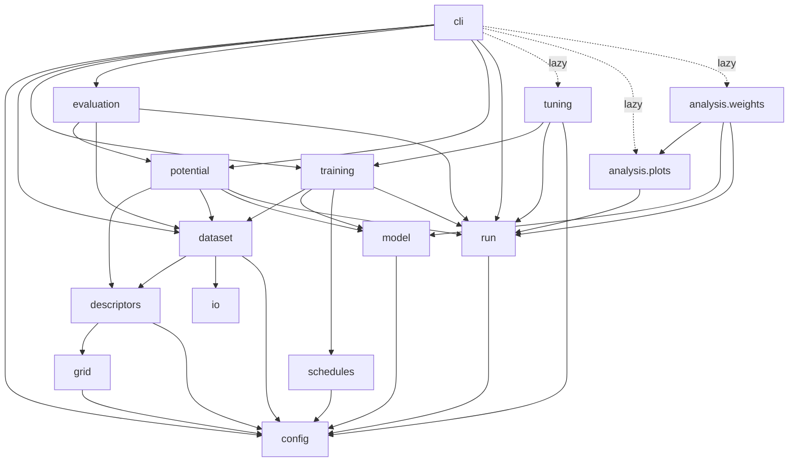
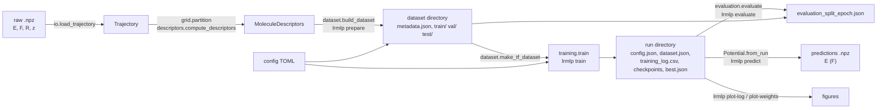

# Architecture

This page describes how the package `lrmlp` is organised. It covers the modules
and their dependencies, the data flow from raw trajectories to predictions, the
public API, the main design decisions and the rules for extending the code. The
method itself is described in [methodology.md](methodology.md), and the file
formats are described in [data-format.md](data-format.md).

## Modules

| Module | Responsibility | Imports TensorFlow? |
|---|---|---|
| `lrmlp.config` | Frozen dataclasses `GridConfig`, `DataConfig`, `ModelConfig`, `TrainConfig`, `ExperimentConfig`, TOML loading, `--set` overrides, validation, derived cutoffs | no |
| `lrmlp.io` | Reading raw `.npz` trajectories (`E`, `F`, `R`, `z`) | no |
| `lrmlp.grid` | Cell assignment (Eq. 4.11), cell levels (Eq. 4.13), cutoff (Eq. 4.14), local / long-range partition per atom (`thesis` / `legacy`), cell centres of mass and element counts (Eq. 4.12) | no |
| `lrmlp.descriptors` | Switching function $s(r)$ (Eq. 4.5), the rows of $\tilde R_i^{local}$, $Z_i$, $\tilde R_i^{long}$, $F_i$ (Eq. 4.4-4.20), row order, padding | no |
| `lrmlp.dataset` | `build_dataset` (descriptors of all frames, optionally with several processes), $N_{max}$, split, `.npy` + `metadata.json` storage, `load_dataset`, tf.data pipelines | only in the tf.data functions |
| `lrmlp.run` | Run directory contract (`RunDirectory`): `config.json`, `dataset.json`, `training_log.csv`, checkpoints, `best.json` | no |
| `lrmlp.model` | Keras 3 layers (`DenseResBlock`, `FirstColumn`, `FeatureMatrix`), `build_model`, `resolve_k1`, weight transfer from the original code | yes |
| `lrmlp.schedules` | Learning-rate schedule (Eq. 4.22) and loss-weight schedule of the force mode | yes |
| `lrmlp.training` | `Trainer` / `train`: compiled training step, validation, logging, checkpoints, best epoch | yes |
| `lrmlp.evaluation` | `evaluate`: energy MAE / RMSE / MSE (Tab. 5.3) and force metrics, dataset check | yes (when called) |
| `lrmlp.potential` | Inference API `Potential`: descriptors + model for many molecules per call | yes (when called) |
| `lrmlp.tuning` | Grid search over configuration overrides, TensorBoard HParams | yes (when called) |
| `lrmlp.analysis` | `plots` (learning curves) and `weights` (weight distributions, Fig. 5.3) | `weights` only |
| `lrmlp.cli` | `lrmlp` command line interface; imports every subcommand's module lazily | lazily |



Arrows point from a module to the modules it imports. `config`, `io`, `grid`,
`descriptors` and `run` depend on NumPy and the standard library only.

## Data flow



1. **Raw data.** `lrmlp.io.load_trajectory` reads the first
   `data.n_samples_per_source` frames of every source and checks shapes and keys.
2. **Descriptors.** For every frame, `lrmlp.grid.partition` splits the atom pairs
   into local and long range. `lrmlp.descriptors.compute_descriptors` builds the
   four matrices per atom, with the atoms in input order.
3. **Dataset.** `lrmlp.dataset.build_dataset` runs step 2 for all frames (in
   chunks, optionally in worker processes). It determines $N_{max}^{local}$ and
   $N_{max}^{long}$, splits 80/10/10 and writes compact, memory-mappable `.npy`
   arrays plus `metadata.json`. This happens once (p. 40).
4. **Training.** `lrmlp.training.train` loads the dataset, builds the model for
   the dataset's $N_{max}$ and trains one molecule per step. It writes the run
   directory: the resolved configuration, a copy of the dataset metadata, the log,
   checkpoints and the best epoch.
5. **Evaluation.** `lrmlp.evaluation.evaluate` loads a checkpoint (`best` by
   default) and computes the metrics on a split. Before that, it checks that the
   dataset matches the run's `dataset.json`.
6. **Inference.** `lrmlp.potential.Potential.from_run` rebuilds the model of a
   run. `Potential.predict` computes descriptors for new positions with the run's
   grid settings and calls the model on many molecules at once.

## Public API

`import lrmlp` exports the following names lazily (`lrmlp.__all__`). The
submodule is imported on first access, so `import lrmlp` alone does not load
TensorFlow.

| Name | Defined in | Signature (abridged) |
|---|---|---|
| `__version__` | `lrmlp` | `str` (`"0.1.0"`) |
| `ExperimentConfig` | `lrmlp.config` | `ExperimentConfig(name, grid, data, model=ModelConfig(), train=TrainConfig())`; `.to_dict()`, `.from_dict(d)`, `.with_overrides(overrides)` |
| `GridConfig`, `DataConfig`, `ModelConfig`, `TrainConfig` | `lrmlp.config` | frozen dataclasses, fields in [configuration.md](configuration.md); `GridConfig.cutoff`, `GridConfig.inner_cutoff` |
| `load_config` | `lrmlp.config` | `load_config(path, overrides=None) -> ExperimentConfig` |
| `compute_descriptors` | `lrmlp.descriptors` | `compute_descriptors(positions, numbers, grid, *, species=None) -> MoleculeDescriptors` |
| `build_dataset` | `lrmlp.dataset` | `build_dataset(config, output_dir=None, n_workers=None, *, overwrite=False) -> Path` |
| `load_dataset` | `lrmlp.dataset` | `load_dataset(path) -> DescriptorDataset` (`.metadata`, `.splits["train" \| "val" \| "test"]`) |
| `build_model` | `lrmlp.model` | `build_model(model_cfg, n_max_local, n_max_long_range, max_atomic_number=100) -> keras.Model` |
| `train` | `lrmlp.training` | `train(config, dataset_dir=None, run_dir=None, initial_weights=None) -> TrainingResult` |
| `evaluate` | `lrmlp.evaluation` | `evaluate(run_dir, split="test", epoch="best", dataset_dir=None, *, batch_size=256, allow_dataset_mismatch=False) -> EvaluationResult` |
| `Potential` | `lrmlp.potential` | `Potential.from_run(run_dir, epoch="best")`; `.predict(positions, numbers, batch_size=256, *, n_workers=1) -> Prediction`; `.predict_descriptors(molecules, batch_size=256)` |

Further module-level functions are public within their modules (`__all__`). The
most important ones are:

| Function | Signature (abridged) |
|---|---|
| `lrmlp.config.parse_overrides` | `parse_overrides(overrides) -> dict[str, Any]` |
| `lrmlp.io.load_trajectory` | `load_trajectory(path, n_samples=None) -> Trajectory` |
| `lrmlp.grid.cutoff_radius` | `cutoff_radius(grid_size, max_local_level) -> float` |
| `lrmlp.grid.assign_cells` | `assign_cells(positions, grid_size) -> CellAssignment` |
| `lrmlp.grid.partition` | `partition(positions, numbers, grid) -> Partition` |
| `lrmlp.grid.cell_aggregates` | `cell_aggregates(positions, numbers, partition, max_atomic_number, species=None) -> CellAggregates` |
| `lrmlp.descriptors.switching_function` | `switching_function(r, cutoff, inner_cutoff) -> ndarray` |
| `lrmlp.descriptors.pad_descriptors` | `pad_descriptors(desc, n_max_local, n_max_long_range) -> dict[str, ndarray]` |
| `lrmlp.dataset.split_indices` | `split_indices(n, val_fraction, test_fraction, seed) -> (train, val, test)` |
| `lrmlp.dataset.make_tf_dataset` | `make_tf_dataset(split, *, shuffle, shuffle_buffer, seed, include_long_range=True) -> tf.data.Dataset` |
| `lrmlp.dataset.make_batched_tf_dataset` | `make_batched_tf_dataset(split, molecules_per_batch, *, include_long_range=True) -> tf.data.Dataset` |
| `lrmlp.model.resolve_k1` | `resolve_k1(value, n_max) -> int` |
| `lrmlp.model.assign_legacy_weights` | `assign_legacy_weights(model, weights_by_class) -> None` |
| `lrmlp.model.layers_in_construction_order` | `layers_in_construction_order(model) -> list[keras.layers.Layer]` |
| `lrmlp.schedules.learning_rate_schedule` | `learning_rate_schedule(train) -> keras.optimizers.schedules.ExponentialDecay` |
| `lrmlp.schedules.loss_weight` | `loss_weight(step, start, limit, decay_steps, decay_rate) -> float` |
| `lrmlp.run.RunDirectory` | `RunDirectory(path)`; `.create(...)`, `.read_config()`, `.read_dataset_metadata()`, `.read_best()`, `.list_checkpoints()`, `.resolve_epoch(epoch)` |
| `lrmlp.run.new_run_dir` | `new_run_dir(run_root, name, *, now=None) -> Path` |
| `lrmlp.tuning.run_search` | `run_search(config_path, space_path, max_trials=None, dry_run=False, run_root=None) -> TrialResults` |
| `lrmlp.analysis.plots.plot_training_log` | `plot_training_log(source, output_dir=None, skip=0, title=None) -> list[Path]` |
| `lrmlp.analysis.weights.plot_weight_distribution` | `plot_weight_distribution(run_a, run_b, output, epoch_a="best", epoch_b="best", boundary=(-1.0, 1.0), bins=150, labels=("With", "Without"), title=None) -> Path` |
| `lrmlp.cli.main` | `main(argv=None) -> int` (exit code) |

Example:

```python
import tempfile
from pathlib import Path

import numpy as np

import lrmlp

out = Path(tempfile.mkdtemp())
config = lrmlp.load_config(
    "tests/fixtures/configs/smoke.toml", ["train.epochs=2", f"train.run_root={out / 'runs'}"]
)
dataset_dir = lrmlp.build_dataset(config, output_dir=out / "dataset")
result = lrmlp.train(config, dataset_dir)
print("test MAE:", lrmlp.evaluate(result.run_dir).energy_mae, "kcal/mol")

with np.load("tests/fixtures/synthetic_small.npz") as data:
    prediction = lrmlp.Potential.from_run(result.run_dir).predict(data["R"], data["z"])
print("energies:", prediction.energies[:3])
```

Run it from the repository root. Like the README quickstart, it uses the
synthetic test data and writes only to a temporary directory.

## Design decisions

**TensorFlow is imported lazily.** `import lrmlp` loads no TensorFlow
(`tests/test_package.py`, `tests/test_public_api.py`). The configuration, raw
data, grid, descriptor and run modules use NumPy only. `lrmlp.dataset` imports
TensorFlow only inside its tf.data functions, and the CLI imports every
subcommand's module only when that command runs. So `lrmlp --help`, `lrmlp info`
and the preprocessing workers start quickly, and the NumPy parts can be used
without TensorFlow.

**Configuration instead of constants.** The original code read global class
attributes from `Constants.py` in every module. Here every function receives its
parameters explicitly or as a frozen, validated config object. One TOML file
describes one experiment, `--set` changes single values, and the run directory
stores the resolved configuration. A run can therefore be evaluated, continued
with inference, or reproduced without the original file. Relative paths in a
configuration are resolved relative to the file, so no command depends on the
working directory (legacy bug B10).

**Data contracts.** The three file boundaries are versioned and documented in
[data-format.md](data-format.md):

- the raw `.npz` trajectory,
- the dataset directory (`metadata.json` with `format_version`, memory-mapped
  `.npy` arrays per split),
- the run directory (with the `.npz` prediction files).

Atoms are always in input order, so descriptor row $a$, force label $a$ and
prediction $a$ belong to the same atom (legacy bug B01). The dataset stores the
element counts compactly and rebuilds the 101 columns of $F_i$ in the input
pipeline. `evaluate` refuses a dataset that does not match the run.

**Legacy profile and golden tests.** The refactoring changes the code, not the
method. Every place where the original code deviated from the thesis is a
configuration switch with the thesis as default (`grid.assignment`,
`model.dropout_rate`, `model.embedding_dims`, `model.fitting_res_blocks`, ...).
`configs/legacy-head.toml` sets all of them to the behaviour of the original code
at commit `9413bfd`. The golden fixtures in `tests/fixtures/golden/` were generated
from the **unchanged** original code (exported with `git archive 9413bfd`;
generators in `tests/golden/`). The golden tests check grid, descriptors, dataset,
model outputs and training steps of `lrmlp` against them in the legacy profile. The
benchmarks repeat the equivalence check on larger workloads
([benchmarks.md](benchmarks.md#equivalence)).

**Speed without changing results.** Descriptors are vectorised per molecule in
NumPy and computed once. Training uses one `tf.function` with a fixed input
signature, several steps per call (`train.steps_per_execution`) and optionally
XLA (`train.jit_compile`). Validation and inference process many molecules per
call and sum per molecule with `segment_sum`, which gives the same result as one
molecule per call. Training keeps $\lvert B\rvert = 1$ (p. 51).

**Explicit invariance limits.** Properties that the method does not guarantee
(rotation invariance, invariance under arbitrary permutation, A10) are documented
and tested as `xfail`. They are not hidden by changing the method
([methodology.md](methodology.md#invariances)).

## Extension rules

- **Do not change the method.** A change to grid, descriptors, model, loss or
  schedules that changes results in the legacy profile must fail the golden tests.
  Put new behaviour behind a configuration switch. Its default follows the thesis,
  and its legacy value keeps the golden tests green.
- **New configuration field.** Add it to the dataclass in `lrmlp.config` with a
  type, a default, validation in `__post_init__` and a docstring entry (thesis
  symbol, legacy name). Add a row to [configuration.md](configuration.md):
  `tests/test_docs.py` fails otherwise. Set it in the presets only if the thesis
  gives a value.
- **No global state.** Pass parameters explicitly. Use `keras` (Keras 3), never
  `tf.keras` or `tf_keras` (ruff `banned-api`). Keep the NumPy modules free of
  TensorFlow imports.
- **New CLI command.** Add it in `lrmlp.cli.build_parser`, import its module inside
  the handler and document it in the README or under `docs/`.
  `tests/test_docs.py` checks that every documented `lrmlp <command>` exists.
- **File formats.** A change to the dataset layout raises
  `lrmlp.dataset.FORMAT_VERSION` and updates [data-format.md](data-format.md).
- **Defaults for speed.** An execution default changes only with a measured gain
  and a passed equivalence check (`benchmarks/`, see
  [benchmarks.md](benchmarks.md)).
- **Checks before a commit:** `ruff check .`, `ruff format --check .`, `mypy src`,
  `pytest -q` (slow end-to-end tests with `pytest -m slow`).
